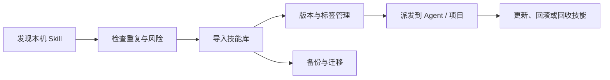

<div align="center">

# SkillHub

### 让每一个 Agent，都能找到、用上并安全管理正确的 Skill

SkillHub 是面向 Windows 和 macOS 的本地 Skill 全生命周期管理工具：
发现、导入、检查、整理、派发、版本管理、备份和更新，一处完成。

[](https://github.com/crocketc/skill-hub/releases)
[](https://github.com/crocketc/skill-hub/actions/workflows/validate.yml)
[](#下载与安装)
[](#当前状态)

[立即下载](https://github.com/crocketc/skill-hub/releases/tag/v0.1.0) · [报告问题](https://github.com/crocketc/skill-hub/issues)

</div>

## 为什么需要 SkillHub？

Skill 越用越多之后，真正麻烦的往往不是“有没有 Skill”，而是：

- 同一个 Skill 散落在 Codex、Claude、Cursor 和不同项目目录里。
- 重名 Skill 内容不同，派发后很难判断各使用位置对应哪个技能主体。
- 更新来源不清楚，删除时又担心误删 Agent 原有文件。
- 每个 Agent 的目录规则不同，普通用户很难记住所有路径。
- Skill 的版本、备份、恢复和跨设备迁移没有统一入口。
- 安全检查、提示词注入和敏感信息风险容易被忽略。

SkillHub 把这些“文件散落、关系不清、操作不敢做”的问题，收敛成一个可追踪的本地工作流。

**技能库统一管理技能主体的内容、版本、元数据与生命周期，Agent 和项目通过使用关系使用技能。**

技能库不会自动接管本地所有目录。导入后，来源位置仍作为导入来源保留；使用位置可按目标能力建立链接或完整拷贝关系。转入管理、回收技能和解除使用关系前会显示影响并核验目标；无法安全处理时保留原文件，不静默覆盖。

## SkillHub 的核心亮点

### 技能库管理技能主体

把 Skill 导入用户选择的技能库，保留来源、版本和使用关系。技能库管理技能主体，包括内容、版本、元数据和生命周期；导入不会悄悄覆盖来源位置的文件。

### 派发到 Agent 和项目

选择一个或多个 Agent、项目后，派发链接或完整拷贝。SkillHub 记录每一条使用关系；解除关系时按关系形式处理目标，不删除技能库主体或导入来源原件。

### 重复与冲突先说清楚

导入前分析内容、来源和运行名称，区分同一技能与重名；相似技能只作为可选的语义提示，不替代确定性判定。需要用户决定的项目会进入治理流程，显示受影响位置与回退方式；未知目录和未决问题不会静默跳过。

### 关系转换可回退

已有使用位置可在确认影响后转入技能库管理，按目标能力选择链接或维护同步的完整拷贝；先备份并核验替代入口，再处理原入口。共享目录迁移会核对全部消费者；部分失败时保留共享来源并提供恢复路径。Agent 详情页展示目录与使用关系，Skill 详情页展示来源和关系影响；可选的 AI 分析只提供建议，不替代确定性检查，也不改写用户决定。

### 确定性安全检查，LLM 只是可选增强

基础检查不依赖大模型，识别危险命令、疑似敏感信息和提示词注入等风险。需要更深层语义分析时，可以单独启用 LLM 检查；它不会替代基础检查，也不会自动修改 Skill。

LLM 接入统一在一个设置入口：25 个内置供应商预设（按产品线区分，如 GLM 普通 API 与 Coding Plan 不复用端点）与自定义 Base URL，模型列表拉取失败可手动填写，连接测试分“服务可达 / 模型可调用 / 结构化输出兼容”三级展示，密钥保存在操作系统凭据存储。请求参数由“传输协议 × 供应商兼容档 × 结构化策略 × 推理策略”四层共同决定，不按名称或地址猜厂商。AI 安全检查、描述翻译、语义重复分析、联网搜索辅助四项能力默认关闭、逐项开关并说明发送范围，详见 [LLM 用户配置与隐私说明](docs/archive/llm/用户配置与隐私说明-2026-09-13.md) 与 [LLM 供应商兼容矩阵](docs/archive/llm/供应商兼容矩阵-2026-09-13.md)。

### 版本、Markdown 和外部变化可追踪

查看 `SKILL.md`、版本差异、来源更新和外部修改。SkillHub 关注“当前文件到底是什么”，让升级、回滚和排查都有依据。

### 备份、迁移和应用内更新

支持备份、恢复和可迁移数据；应用更新使用签名清单和平台更新包校验，安装完成后自动重启，失败时保留回滚路径。

### 为普通用户降低门槛，为开发者保留控制权

普通用户可以通过向导和可视化操作管理 Skill；开发者仍可以查看路径、选择完整拷贝或链接、使用自定义目录，并通过 CLI 和本地 CI 保持可复核性。

## 一眼看懂工作流



## 当前状态

当前公开发布版本为 **`0.1.0` 早期版本**。`feat/v0.2.0-product-completion` 分支上的统一关系体系属于后续开发，尚未发布。

已覆盖的核心方向：

- 本地 Skill 发现、导入和技能库主体管理
- Agent/项目目录识别与使用关系管理
- 链接或完整拷贝派发，以及回收技能和解除使用关系
- 重复/冲突分析、版本管理和 Markdown 预览
- 基础安全检查与可选 LLM 检查
- 备份、恢复、迁移和应用内更新
- Windows 11 与 macOS 的本地 CI 验证

统一关系体系 T01—T22 已完成代码、全量自动化与发布检查；CJK（中日韩字符）审计仍有既有债务。Windows/macOS 真实桌面人工验收尚未执行，自动化结果不代表人工通过。当前实施进度见[开发状态](docs/development/开发状态-2026-10-15.md)、[自动化测试说明](docs/development/自动化测试说明-2026-10-15.md)、[人工验收清单](docs/development/人工验收清单-2026-10-15.md)和[验收矩阵](docs/development/功能完成度与验收状态矩阵-2026-10-15.md)。

实验能力（仅供参考）：

- 使用证据分析
- Agent 运行时 Hook 关联能力
- 部分 Agent 的真实运行时行为验证

## 下载与安装

前往 [v0.1.0 Release](https://github.com/crocketc/skill-hub/releases/tag/v0.1.0) 下载对应平台的安装包。

### Windows 11

| 设备 | 下载文件 |
| --- | --- |
| Intel / AMD | Windows x64 安装包 |
| Windows ARM 设备 | Windows ARM64 安装包 |

安装使用当前用户模式，不需要管理员权限。

当前版本未购买 Authenticode 证书，SmartScreen 可能显示“未知发布者”。请确认 Release 来源、SHA-256 校验值和文件名后，再决定是否继续安装。项目不提供绕过 SmartScreen 的命令。

### macOS

Intel 和 Apple Silicon 均下载 **macOS Universal DMG**。DMG 只用于首次安装，日常升级使用应用内签名更新包。

当前版本使用 ad-hoc 签名且未进行 Apple 公证，首次打开可能出现安全提示。确认来源后，可在“系统设置 → 隐私与安全性”中允许打开，或在 Finder 中使用“打开”确认。项目不提供绕过 Gatekeeper 的命令。

## 应用内更新

SkillHub 不要求普通用户手动打开 GitHub 页面才能升级。应用会：

1. 检查版本清单和当前平台。
2. 下载对应平台的更新包。
3. 校验摘要和 minisign 签名。
4. 安装更新并自动重启。
5. 如果安装失败，尝试恢复上一版本；如果清单缺失或签名不匹配，则停止安装并提示用户处理。

Windows 更新包使用 `.nsis.zip`，macOS 更新包使用 `.app.tar.gz`。DMG 只用于首次安装，不参与应用内更新。

### 发布资源怎么选

普通用户只需下载对应平台的 `.exe` 或 `.dmg`。`.nsis.zip`、`.app.tar.gz`、`.sig` 和 `latest.json` 是应用内更新使用的后台资源，不需要手动操作。校验和、SBOM、发布元数据和详细安装说明属于高级用户/审计资料，单独保存在发布证据中，不影响普通安装。

## 支持范围与兼容性

### 操作系统

- Windows 11：x64、ARM64
- macOS：Intel、Apple Silicon（Universal）
- Linux：当前不在 V1 默认支持范围内

### Agent

SkillHub 使用适配器识别各 Agent 的个人级、项目级和自定义 Skill 目录。候选平台包括 Codex、Claude Code、Claude Desktop、Gemini CLI、Cursor、Cline、GitHub Copilot、Windsurf、OpenCode、Trae、Qoder、CodeBuddy、Comate、Kimi Code、OpenClaw、Hermes Agent、Grok Build、ZCode、Pi coding agent、DeepSeek Harness 等。

兼容性分为“能识别目录”和“Agent 实际会执行 Skill”两个层次。SkillHub 负责前者以及文件派发，不假设目标 Agent 一定会加载或执行某个 Skill。

## 数据、隐私与安全边界

- 目录索引、使用关系、版本和操作记录默认保存在本机。
- 用户 Skill、API Key、个人配置和技能库路径不会提交到本项目仓库。
- 联网搜索、来源获取和 LLM 检查均为可选功能，启用前请确认数据发送范围。
- LLM API 密钥只保存在操作系统凭据存储；技能库、备份和标准导出只保留引用，不含密钥明文。
- SkillHub 不负责安装 Skill 运行所需的 Python、ffmpeg、MCP 或其他外部工具。
- 不会静默覆盖用户文件；完整拷贝、链接、解除使用关系和删除都需要明确的操作路径。
- 未签名/未公证安装包不会被描述为“绕过” Windows 或 macOS 安全审查。

## 已知限制与后续方向

- 早期发布包尚未使用付费 Windows Authenticode 或 Apple Developer ID/公证服务。
- 一些 Agent 没有公开、稳定或可写的 Skill 目录，可使用自定义目录兜底。
- NAS、百度云盘、夸克云盘、iCloud 等网络存储属于后续大版本方向，当前以本地文件系统为主。
- 使用证据分析和运行时 Hook 属于实验/关联能力，不是核心管理流程的前置条件。
- 不同 Agent 的内部加载、授权和运行时行为，仍需要各平台自行验证。

## 开发者指南

### 技术栈

- Rust：核心领域模型、文件安全、存储和应用流程
- Tauri 2：Windows/macOS 桌面端
- React + Vite：桌面端界面
- SQLite：本地持久化
- Specta：Rust 合约到 TypeScript bindings

### 环境要求

- Rust stable，包含 `rustfmt` 和 `clippy`
- `cargo-deny`
- Node.js 22（Node.js 24 也可用于本地检查）
- pnpm `11.21.0`

### 启动开发环境

```powershell
pnpm --dir apps/desktop install --frozen-lockfile
pnpm --dir apps/desktop tauri dev
```

### 运行本地质量检查

Windows 11：

```powershell
.\scripts\ci-local.ps1
```

macOS：

```bash
chmod +x ./scripts/ci-local.sh
./scripts/ci-local.sh
```

跨平台入口：

```bash
node ./scripts/ci-local.mjs
```

本地 CI 会按顺序执行 Rust 格式、依赖与许可证策略、Clippy、Rust 测试、前端依赖与安全审计、ESLint、TypeScript、Vitest 和生产构建。

## 项目结构

```text
crates/skillhub-core/          跨平台领域模型、文件安全和核心规则
crates/skillhub-storage/       SQLite 存储与持久化
crates/skillhub-application/   应用流程、命令和查询门面
crates/skillhub-cli/           轻量 CLI 入口
apps/desktop/src-tauri/        Tauri 2 本地后端
apps/desktop/src/              React/Vite 前端
tests/                         跨平台夹具、集成测试和端到端测试
docs/                          安装、发布和依赖说明
```

## 文档导航

- [Agent通用开发规则](AGENTS.md)：开发、测试、安全与协作约束，以及按任务阅读的文档路由。
- [产品规范索引](docs/product/README.md)：产品定位/模型边界、界面约定和抽屉/详情/列表操作分工；具体产品规则不在AGENTS.md反复追加。
- [项目文档索引](docs/README.md)：当前开发入口、实施计划与历史归档。
- [下一阶段团队交接指令](docs/archive/decisions/plans/2026-10-04-技能功能补全团队交接指令.md)：主代理统筹，两个执行代理分别负责后端与前端。

- [发布流程](docs/release-process.md)
- [发布检查清单](docs/release-checklist.md)
- [依赖与供应链策略](docs/dependency-policy.md)
- [安装说明](docs/install/)
- [LLM 用户配置与隐私说明](docs/archive/llm/用户配置与隐私说明-2026-09-13.md)
- [LLM 供应商兼容矩阵](docs/archive/llm/供应商兼容矩阵-2026-09-13.md)
- [开发状态](docs/development/开发状态-2026-10-15.md) / [自动化测试说明](docs/development/自动化测试说明-2026-10-15.md) / [人工验收清单](docs/development/人工验收清单-2026-10-15.md) / [功能完成度与验收状态矩阵](docs/development/功能完成度与验收状态矩阵-2026-10-15.md)
- [LLM 技术架构决策](docs/archive/llm/架构决策-2026-09-10.md)

## 反馈与贡献

欢迎通过 [GitHub Issues](https://github.com/crocketc/skill-hub/issues) 报告问题或提出建议。请尽量提供：

- 操作系统及版本
- SkillHub 版本
- 目标 Agent 及版本
- 可复现步骤和错误信息
- 使用的是完整拷贝派发、链接派发还是自定义目录

请勿在 Issue、日志或提交中上传 API Key、密码、个人 Skill 内容或完整用户目录路径。

## English summary

SkillHub is a local Skill lifecycle manager for Windows and macOS. It discovers, imports, checks, versions, dispatches, backs up, and updates Agent Skills while preserving user-owned files. The `0.1.0` release is an early distribution with unsigned/notarized-install limitations; verify release assets and follow the operating-system security prompts.
